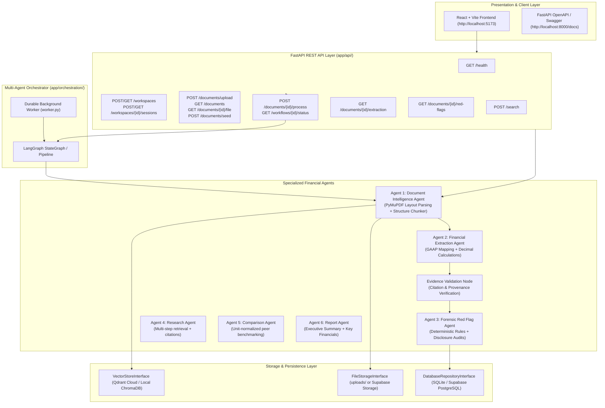

# Multi-Agent Financial Research System
**Infosys Springboard — Vidzai Digital**  
**Milestones 1–3: Document Intelligence, Financial Extraction, Evidence-Validated Red Flags, Orchestration, Grounded Research, Company Comparison, and Initial Report Generation**

---

## 1. Project Overview

The **Multi-Agent Financial Research System** is an enterprise-grade AI solution engineered to ingest, parse, analyze, benchmark, and report on complex corporate financial disclosures:
- **Annual Reports & Statutory Disclosures** (e.g., Integrated Annual Reports, Auditor Reports, Notes to Accounts).
- **Financial Statements** (Consolidated and Standalone Balance Sheets, Statements of Profit and Loss, Cash Flow Statements).
- **SEC Filings** (Form 10-K Annual Reports, Form 10-Q Quarterly Reports).
- **Earnings Call Transcripts** (Executive management commentary, financial reviews, analyst Q&A).

### Core Directive: Strict Source Grounding & Zero Hallucination
- Every extracted financial figure, calculated ratio, and forensic risk finding is bound to an exact source document and verifiable page citation.
- Tabular financial structures are preserved to prevent column/row misalignment.
- Deterministic financial mathematics mandate Python `Decimal` rather than LLM arithmetic.
- Qualitative disclosure audits detect auditor qualifications, going-concern uncertainties, and debt/margin deterioration.

---

## 2. Implemented Architecture & Agents



---

## 3. Technology Stack

| Layer | Component | Description |
|---|---|---|
| **Web API** | FastAPI + Uvicorn | Asynchronous Python REST API with OpenAPI documentation |
| **Frontend** | React 18 + Vite | Analyst dashboard, document library, and analytical workspace |
| **PDF Parsing** | PyMuPDF (fitz) | High-speed layout parsing and Markdown table extraction |
| **Embeddings** | OpenAI Embeddings (`text-embedding-3-small`, 1536-dim) / Local MiniLM (`all-MiniLM-L6-v2`, 384-dim) | Dense vector generation for semantic cosine retrieval |
| **Vector DB** | Qdrant / ChromaDB | Qdrant REST client with automatic persistent ChromaDB fallback |
| **Relational DB** | SQLite (`documents.db`) / Supabase PostgreSQL | Tables for documents, metrics, evidence, red flags, jobs, and runs |
| **Orchestration** | LangGraph / Typed State Machine | Sequential agent execution with durable job tracking |
| **Reasoning LLM** | OpenAI `gpt-6.1-sol` (Responses API) / Mock | Structured parsing with Pydantic schemas and refusal handling |
| **Math Engine** | Python `Decimal` | Exact accounting precision with zero floating-point drift |

---

## 4. Quick Start & Execution Guide (Windows PowerShell)

### Step 1: Backend Setup & Seed Ingestion
Open **Terminal 1**:
```powershell
# From the repository root, navigate to the backend directory
cd Engine

# Create and activate a Python virtual environment
python -m venv venv
.\venv\Scripts\Activate.ps1

# Install / verify requirements
pip install -r requirements.txt

# Copy the environment template and adjust values as needed
copy .env.example .env

# Generate realistic financial seed PDFs (5 company filings)
python scripts\create_seed_pdfs.py

# Ingest and index seed filings into the Vector Database
python scripts\test_seed_ingestion.py

# Start the FastAPI Server on port 8000
python -m uvicorn main:app --host 127.0.0.1 --port 8000 --reload
```

### Step 2 (Optional): Start the Durable Background Job Worker
Open **Terminal 2**:
```powershell
cd Engine
.\venv\Scripts\Activate.ps1

# Start the persistent database-backed job worker
python worker.py
```

### Step 3: Start the React + Vite Frontend
Open **Terminal 3**:
```powershell
# Navigate to frontend directory (sibling of Engine)
cd Frontend
npm ci

# Start the development server
npm run dev
```
Open your browser at `http://localhost:5173`. The Vite dev server proxies `/api` to
`http://localhost:8000`.

---

## 5. Automated Verification Test Suite

Run the full suite across Milestones 1–3 in **Terminal 4**:
```powershell
cd Engine
.\venv\Scripts\Activate.ps1

# Complete suite (115 tests; uses an isolated temporary database and vector index)
python run_tests.py

# Milestone 2.4 seed validation across all 5 bundled filings
python scripts\validate_seed_documents.py
```

To run individual modules:
```powershell
# 1. Document Agent, Parser, Chunker, Embedder, and Vector Store
python -m unittest tests\test_document_agent.py tests\test_parser.py tests\test_chunker.py tests\test_embedder.py tests\test_vector_store.py

# 2. Database Repositories, Workspaces, Sessions, and Job Claiming
python -m unittest tests\test_database.py

# 3. Extraction Agent, Normalizer, Python Decimal Calculations, and LLM Provider
python -m unittest tests\test_extractor.py tests\test_normalizer.py tests\test_calculations.py tests\test_llm_provider.py

# 4. Red Flag Rules, Disclosure Analyzer, and Evidence Validation
python -m unittest tests\test_red_flag_rules.py tests\test_red_flag_analyzer.py tests\test_validation.py

# 5. Multi-Agent Orchestration & End-to-End Pipeline
python -m unittest tests\test_orchestration.py tests\test_milestone2_e2e.py

# 6. Milestone 2.4 evidence validation and Milestone 3 agents
python -m unittest tests\test_m24_validation.py tests\test_m3_agents.py tests\test_audit_repairs.py

# 7. Multi-Document Data Isolation & Zero Cross-Contamination Acceptance Test
python -m unittest tests\test_multi_document_isolation.py
```

---

## 6. Preloaded Financial Seed Documents

The system pre-populates 5 bundled corporate financial filings:
1. **Zenith Energy Resources Corp.** (`zenith_energy_earnings_call_q4_fy25.pdf`):
   - Q4 FY25 Earnings Call Transcript.
   - Revenue: $8,420M, Operating Cash Flow: $2,650M, Capital Expenditure: $1,120M, Total Debt: $3,800M.
2. **Acme Cloud Technologies, Inc.** (`acme_cloud_technologies_sec_10k_fy25.pdf` & `acme_tech_10k_fy25.pdf`):
   - SEC Form 10-K Annual Report.
   - Revenue: $14,300M, Gross Profit: $9,750M, Net Income: $1,184M, Total Assets: $18,600M.
3. **Apex Financial Holdings Group** (`apex_financial_holdings_annual_report_fy25.pdf`):
   - Annual Statutory Banking Report.
   - Basel III CRAR: 16.8%, CET1: 13.4%, Total Assets: $94,500M, Operating Profit: $4,630M.
4. **Infosys Limited** (`infosys_annual_report_fy24.pdf`):
   - Integrated Annual Report 2023-24.
   - Revenue from Operations: ₹153,670 Cr, Operating Profit: ₹31,747 Cr (20.7%), Net Profit: ₹26,248 Cr, Total Debt: 0 (Debt-free).

---

## 7. API Endpoints Reference

| Method | Path | Description |
|---|---|---|
| `GET` | `/health` | Live system readiness: DB, storage, vector store, embedding dimension, LLM status, worker queue |
| `POST` | `/workspaces` | Create a named research workspace |
| `GET` | `/workspaces` | List all research workspaces |
| `POST` | `/workspaces/{id}/sessions` | Create a named research session within a workspace |
| `GET` | `/workspaces/{id}/sessions` | List sessions belonging to a workspace |
| `POST` | `/documents/upload` | Upload PDF, deduplicate by SHA-256, parse, chunk, embed, index, and queue job |
| `GET` | `/documents` | List all ingested documents with metadata and page/chunk counts |
| `GET` | `/documents/{id}` | Retrieve document summary by ID |
| `GET` | `/documents/{id}/file` | Download/stream the original stored PDF binary |
| `POST` | `/documents/seed` | Ingest and index preloaded seed company documents |
| `POST` | `/documents/{id}/process` | Trigger sequential multi-agent analysis pipeline |
| `GET` | `/documents/{id}/status` | Query agent processing lifecycle status |
| `GET` | `/documents/{id}/extraction` | Retrieve extracted financial statement metrics and ratios |
| `GET` | `/documents/{id}/red-flags` | Retrieve detected forensic red flag risk findings and citations |
| `GET` | `/workflows/{job_id}/status`| Query execution status of a background processing job |
| `POST` | `/search` | Semantic cosine vector retrieval with page and table filters |
| `DELETE`| `/documents/{id}` | Safely remove document file, vectors, and database records |
| `POST` | `/research/sessions/{id}/query` | Grounded multi-part question with citations and session context |
| `POST` | `/research/query` | Stateless grounded research query |
| `GET` | `/research/sessions/{id}/messages` | Persisted research conversation turns |
| `DELETE`| `/research/sessions/{id}/messages` | Clear research session context |
| `POST` | `/comparison` | Side-by-side company metric comparison with unit/period warnings |
| `POST` | `/reports/generate` | Generate Executive Summary and Key Financials sections |

See `docs/API_REFERENCE.md` for request/response contracts.

---

## 8. Local Setup, Run, and Test

### Backend (Windows)

```powershell
cd Engine
python -m venv venv
.\venv\Scripts\python.exe -m pip install -r requirements.txt
# optional offline profile: copy .env.example to .env and set
# EMBEDDING_PROVIDER=hashing, VECTOR_STORE_TYPE=chroma, LLM_PROVIDER=mock, STORAGE_PROVIDER=local
.\venv\Scripts\python.exe -m uvicorn main:app --host 0.0.0.0 --port 8000
```

`python -m venv` plus the core dependencies (FastAPI, PyMuPDF, ChromaDB, SQLAlchemy) is
sufficient for the offline profile. `sentence-transformers`/`torch` are optional; when they
are not installed the deterministic 384-d hashing embedder is used automatically.

### Frontend

```bash
cd Frontend
npm ci
npm run dev
```

The Vite dev server proxies `/api` to `http://localhost:8000`.

### Tests and seed validation

```powershell
cd Engine
.\venv\Scripts\python.exe run_tests.py
.\venv\Scripts\python.exe scripts/validate_seed_documents.py
```

The validation script writes `docs/VALIDATION_REPORT.md` and `docs/validation_report.json`.

### Environment variables (new in M3)

No new secret is required. Relevant settings:

- `EMBEDDING_PROVIDER` — `hashing` (offline), `sentence-transformers`, or `openai`
- `VECTOR_STORE_TYPE` — `chroma`, `qdrant`, or `auto`
- `LLM_PROVIDER` — `mock` (offline), `openai`, or `gemini`
- Existing database/storage variables are unchanged.

Documentation: `docs/API_REFERENCE.md`, `docs/MILESTONE_2_4_AND_3_IMPLEMENTATION.md`,
`docs/VALIDATION_REPORT.md`, `docs/IMPLEMENTATION_STATUS.md`.
